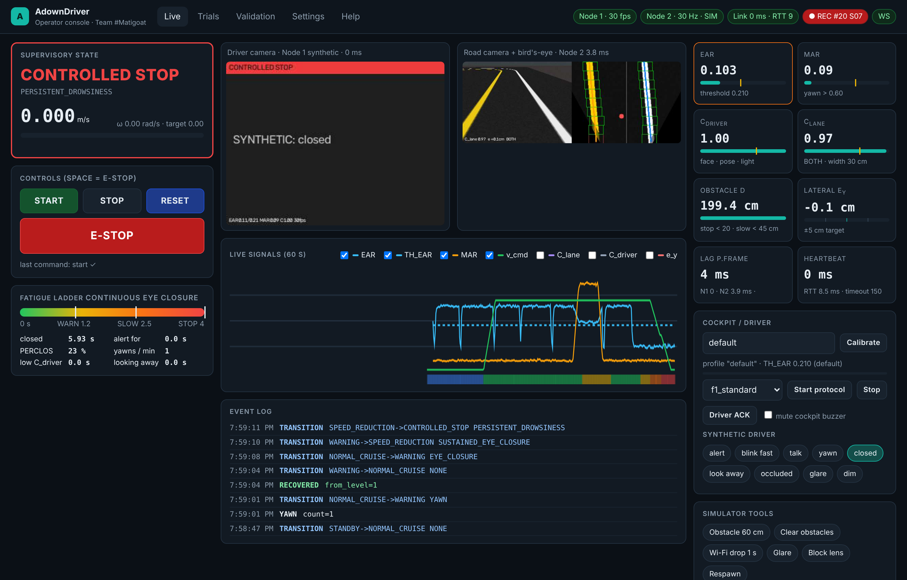

# AdownDriver — drowsiness-aware supervisory control for a TurtleBot 3

[](https://www.inha.ac.kr)
[]()
[]()
[](logs/validation/REPORT.md)

**Team #Matigoat** · Advisor Prof. Mehdi Pirahandeh · Leader Li Vladislav (12250245)

A volunteer sits at a **cockpit station** (Node 1: Raspberry Pi 4B + Logitech C270). Node 1 tracks
the face with MediaPipe and streams eye/mouth state at 50 Hz to the **TurtleBot 3** (Node 2), which
follows a taped lane with its Pi Camera V2 and watches the road with a VL53L1X laser sensor. When
the driver gets drowsy the robot does not just beep: it steps through a **graduated safe stop** —
WARNING → SPEED_REDUCTION → CONTROLLED_STOP — and stops centred in its lane. Obstacles, Wi-Fi loss
or lost lane markings trigger an immediate EMERGENCY_STOP.



---

## 0 · Task launcher — pick any task or sub-task

```bash
python -m adowndriver --config config/sim.yaml ui     # opens http://127.0.0.1:8000/#tasks
python -m adowndriver menu                            # same launcher as a terminal menu (SSH on a Pi)
```

The **Tasks** tab lists the 9 project tasks of the team plan and their 25 runnable sub-tasks
(owner, where it runs, missing packages, expected duration). Choose one, set its parameters and
press *Run* / *Start*: the output streams live, plots and reports open next to the log, and node
services feed the **Live** tab. A five-step mission flow (check hardware → calibrate → validate in
SIL → drive → score & report) and a search box (`/`) find the right sub-task quickly. Only commands
from the catalogue (`adowndriver/launcher/catalog.py`) can be started and every parameter is validated.

| Task | Owner(s) | Sub-tasks |
|---|---|---|
| T1 Driver monitoring (Node 1) | Andrey Li | webcam node, synthetic driver, EAR calibration, analyzer tests |
| T2 Road perception & lane keeping | Nikita Pak | TurtleBot node, simulated track, homography tool, lane/control tests |
| T3 Supervisory safety FSM | Li Vladislav, Arsen Baktybek uulu, Dilshod Obidov | FSM tests, one SIL scenario |
| T4 Telemetry & audit | Vadim Lifrov, Husan Tulaev, Dilshod Obidov | protocol/audit tests, score a run → CSV |
| T5 Operator HMI & demo | Hsu Shwe Sin Htun, Sevinchxon Khoshimova | one-click demo, demo with your own face |
| T6 Hardware bring-up | Saidumar Egamberdiev, Vadim Lifrov | self-test Node 1 / Node 2 |
| T7 CAD & 3D-printed mounts | Fazliddin Igamberdiev | regenerate STL + preview |
| T8 Validation & QA | Dilshod Obidov | 16-scenario SIL, all tests, regression gate, fault-injection subset, driver-state subset |
| T9 Documentation, protocols & evidence | Sevinchxon Khoshimova | evidence pack (full / fast), guided F1 protocol on Node 1 |

## 1 · Try it in 2 minutes (no hardware)

```bash
git clone https://github.com/liyskii/AdownDriver---VIP.git && cd AdownDriver---VIP
python3 -m venv .venv && source .venv/bin/activate        # Windows: .venv\Scripts\activate
pip install -r requirements.txt
python -m adowndriver --config config/sim.yaml demo        # simulated robot + synthetic driver + dashboard
```

Open **http://127.0.0.1:8000** → press **START** → in *Cockpit / driver* click **closed** (synthetic
driver closes the eyes) and watch the graduated stop; *Simulator tools* place obstacles, drop the
Wi-Fi, add glare, etc.
Use your own face instead of the synthetic driver: `pip install mediapipe opencv-python` and
`python -m adowndriver --config config/sim.yaml demo --source 0`.

Run the full 16-scenario validation: `python -m adowndriver validate --plot` (≈ 2 min, report in `logs/validation/`).

## 2 · On the real robot

| | Node 1 — cockpit (IoT-kit Pi 4B) | Node 2 — TurtleBot 3 |
|---|---|---|
| OS | Raspberry Pi OS Bookworm 64-bit | Ubuntu 22.04 + ROS 2 Humble (ROBOTIS image) |
| Install | `bash deploy/setup_node1.sh` | `bash deploy/setup_node2.sh` |
| Check | `python -m adowndriver check --role node1` | `python -m adowndriver check --role node2` |
| Run | `python -m adowndriver node1` (HUD window) | `ros2 launch turtlebot3_bringup robot.launch.py` then `python -m adowndriver node2` and `python -m adowndriver dashboard` |
| Autostart | `systemctl enable adown-node1` (done by setup) | `adown-node2`, `adown-dashboard` (done by setup) |

1. Wire the peripherals → [docs/HARDWARE_WIRING.md](docs/HARDWARE_WIRING.md). Print the mounts and the two enclosures → [cad_models/](cad_models/CAD_SPECIFICATIONS.md).
2. Configure the travel router and IPs → [docs/NETWORK.md](docs/NETWORK.md), `config/default.yaml`.
3. Calibrate the road camera once: `python3 tools/calibrate_lane.py` (4 clicks) and paste the result into `config/default.yaml`.
4. Open `http://<node2-ip>:8000` on a laptop or phone. Calibrate the driver (button A or *Calibrate*), place the robot, **START**.

### Operator controls

| Action | Dashboard | Hardware |
|---|---|---|
| Start / soft stop | START / STOP | — |
| Emergency stop (latched) | E-STOP or **Space** (floating button on phones) | Node 2 button A |
| Reset after a stop | RESET | Node 2 button B · driver ACK = Node 1 button B (only when the driver is alert) |
| Driver calibration (5 s) | Calibrate | Node 1 button A |
| Scored trial | *Trials* → Start recording → Stop & score | — |
| Live tuning | *Settings* (thresholds, speeds, PID) | — |

## 3 · How it works

```
Node 1 (cockpit)                         Node 2 (TurtleBot 3)
C270 → FaceLandmarker → EAR/MAR/yaw  ─50 Hz UDP─►  Safety FSM ◄─ VL53L1X (30 Hz)
       C_driver, per-driver TH_EAR                      ▲     ◄─ Pi Cam V2 → bird's-eye lane (e, ψ, κ, C_lane)
buzzer/LED/OLED ◄──── state 20 Hz ────────────────      │
                                                  velocity profiler + lane-keeping (FF+PID) → /cmd_vel
                    dashboard (FastAPI, WebSocket) ◄── telemetry, video, audit DB (SQLite/CSV)
```

| State | Trigger | Speed | Cockpit |
|---|---|---|---|
| STANDBY | power-up, RESET | 0 | blue |
| NORMAL_CRUISE | driver alert | 0.16 m/s | green |
| WARNING | eyes closed ≥ 1.2 s · yawn ≥ 0.8 s · PERCLOS ≥ 25 % · looking away ≥ 2 s | 0.16 | yellow, beep 1 Hz |
| SPEED_REDUCTION | closed ≥ 2.5 s · 3 yawns/min · face not visible ≥ 0.5 s | 0.08 | orange, fast beep |
| CONTROLLED_STOP | closed ≥ 4 s · driver missing ≥ 5 s | ramp −0.06 m/s², lane keeping on | red, continuous |
| EMERGENCY_STOP | obstacle < 20 cm · heartbeat > 150 ms · lane lost > 0.3 s · ToF fault · E-STOP | 0 immediately | red |

Blinks (< 0.4 s) can never escalate: the timer measures **continuous** closure. Details, maths and
diagrams: [docs/ARCHITECTURE.md](docs/ARCHITECTURE.md). Everything we changed relative to the midterm
specification and why: [docs/SPEC_REVISION.md](docs/SPEC_REVISION.md).

## 4 · Acceptance metrics

| # | Metric | Target | SIL result (16 scenarios) | Arena |
|---|---|---|---|---|
| M1 | Drowsiness detection F1 | ≥ 0.90 | 1.00 | guided protocol, [docs/VALIDATION_PROTOCOL.md](docs/VALIDATION_PROTOCOL.md) |
| M2 | Blink false alarms (slow-down/stop) | 0 | 0 | " |
| M3 | Processing lag per frame (p95) | ≤ 100 ms | Node 2 pipeline < 10 ms (dev PC) | measured per tick on both Pis |
| M4 | Lane deviation during controlled stop | ≤ ±5 cm | 1.1 cm (ground truth) | camera estimate + tape mark |
| M5 | Obstacle / disconnect braking | ≤ 200 ms | 179 ms worst case (link) | `BRAKE` events |

SIL numbers come from the simulator and are a regression check, **not** a substitute for the arena
trials (M3 for Node 1 in particular must be measured on the Pi). Every run — simulated or real —
is stored in `logs/adown_audit.db` and can be exported as CSV from the *Trials* tab or with
`python -m adowndriver report <run_id>`.

## 5 · Development

```bash
pip install -r requirements-dev.txt
pytest -q                               # 53 tests: FSM, lane detector, control, analyzer, audit, SIL
python -m adowndriver validate S08 --plot
python cad_models/generate_stl.py       # rebuild the printable parts
```

Repository map: `adowndriver/` (code), `config/` (YAML, driver profiles, guided protocols),
`docs/`, `tests/`, `tools/`, `cad_models/`, `deploy/`, `logs/` (audit DB, CSV, validation report).

## 6 · Team

| ID | Name | Responsibility |
|:---:|---|---|
| 12250245 | **Li Vladislav** (leader) | Architecture, safety FSM, dual-Pi integration |
| 12250249 | Li Andrey | Node 1 vision: FaceLandmarker, EAR/MAR, EMA, calibration |
| 12250247 | Pak Nikita | Node 2 road perception, bird's-eye warp, lane keeping |
| 12240192 | Vadim Lifrov | Embedded / UDP telemetry, ROS 2 actuation, deployment |
| 12240198 | Hsu Shwe Sin Htun | Operator dashboard (FastAPI) |
| 12240221 | Egamberdiev Saidumar | Hardware assembly: ToF, buzzers, LEDs, power |
| 12240236 | Husan Tulaev | SQLite/CSV audit logging |
| 12225243 | Dilshod Obidov | Validation: simulator, 16 scenarios, fault injection |
| 12240234 | Fazliddin Igamberdiev | CAD: parametric 3D-printed mounts |
| 12225262 | Arsen Baktybek uulu | Confidence matrix, faults & watchdog |
| 12240216 | Sevinchxon Khoshimova | Documentation, compliance, demo video |
