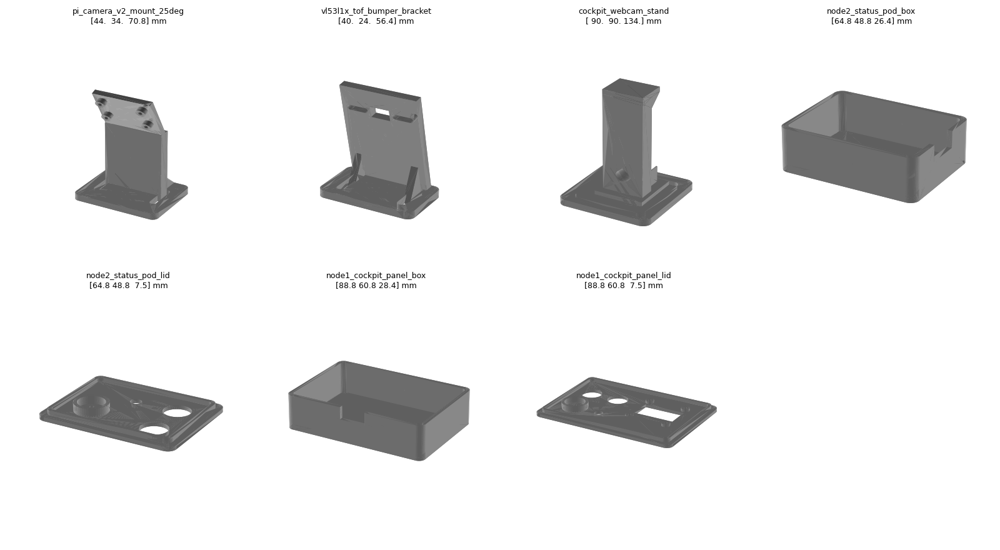

# 3D-printed parts (`cad_models/`)

All STL files are generated from **`generate_stl.py`** (parametric, watertight, one body per file,
exported in print orientation). Edit the parameters at the top and run
`python3 cad_models/generate_stl.py` (`pip install manifold3d trimesh matplotlib`). The script refuses
to export a part that is not watertight, not on the bed or larger than the printer.
Import the STL into Fusion 360 for further edits.

## Parts

| File | Node | Size (mm) | Fastening | Purpose |
|---|---|---|---|---|
| `pi_camera_v2_mount_25deg.stl` | Node 2 top plate | 44 × 34 × 71 | 2 × M3 in 16 mm slots (+ M3 standoffs to set height) | Holds the Pi Camera V2 (4 × M2, 21 × 12.5 mm pattern, on 3 mm bosses for rear-component clearance) at a fixed **25° down-tilt**, lens ≈ 57 mm above the mount face. The homography in `camera_model.py` assumes this angle. |
| `vl53l1x_tof_bumper_bracket.stl` | Node 2 front | 40 × 24 × 56 | base: 2 × M3 slots; sensor: 2 × M2.5 horizontal slots (13–25 mm hole spacing) | VL53L1X on the outer face, centre ≈ 44 mm above the mount face, **tilted 10° up** (see below). |
| `cockpit_webcam_stand.stl` | Node 1 desk | 90 × 90 × 134 | — | C270 hangs on the 6 mm ledge with its own clip (the C270 has no tripod thread). Ballast pocket open at the top: fill with M3 nuts/coins. USB pass-through 14 mm (the USB-A plug fits). |
| `node2_status_pod_box.stl` + `_lid.stl` | Node 2 (any waffle plate, buttons reachable) | 65 × 49 × 26 + lid 7.5 | 2 × M3 slots in the floor | E-STOP (A, one dot) / RESET (B, two dots) buttons, RGB LED, active buzzer of Node 2 — replaces the loose breadboard on the moving robot. 16 × 10 mm notch for the Dupont leads to the Pi header. |
| `node1_cockpit_panel_box.stl` + `_lid.stl` | Node 1 desk | 89 × 61 × 28 + lid 7.5 | — | Cockpit panel: 0.96″ SSD1306 OLED window (module on 4 × M2 self-tapping screws), CALIBRATE (A) / ACK (B) buttons, RGB LED, buzzer. |

**Enclosure parts to measure before printing** (parameters at the top of the script):
`BTN_HOLE` 12.4 mm (12 mm panel push button or the cap of a 12 × 12 tactile switch), `LED_HOLE` 5.2 mm
(5 mm LED, the flange stops it from inside), `BUZZER_D` 12.4 mm (12 mm active buzzer, press-fit in the
ring under the lid), `OLED_HOLES` 23.5 × 23.8 mm (varies 23–24 mm between vendors). The lid is a
friction fit (0.3 mm clearance per side); a drop of glue or a strip of tape if it is loose.
The wiring is unchanged (docs/HARDWARE_WIRING.md) — only the housing.

### Why the ToF bracket is tilted (revision 3)

The VL53L1X has a 27° field of view (13.5° half angle). Mounted level at h ≈ 45 mm, the lower edge of
the cone reaches the floor at h / tan 13.5° ≈ **0.19 m** — right at the 20 cm EMERGENCY_STOP threshold,
so the floor could produce false emergency stops. Tilting the sensor 10° up leaves the lower edge
3.5° below horizontal: the floor enters the cone only at ≈ 0.7 m (h = 45 mm) and objects taller than
≈ 3 cm are still seen at 20 cm. Change `TOF_PITCH_UP_DEG` if your obstacles are lower.

## Printing at ISE (room M-124)

Printer: **MakerBot Sketch Large Classroom**, max build **220 × 220 × 250 mm** — every part fits.

1. Sign in to UltiMaker Digital Factory with an UltiMaker account → **Prepare** → printer *MakerBot Sketch Large*.
2. Upload the STL. The parts are already in print orientation (flat face down, lids top face down) — do not rotate.
3. Slice, check the print preview, download the **.makerbot** file.
4. Book a slot at the SGCS office and hand over the .makerbot file.

| Setting | Value |
|---|---|
| Material | PLA 1.75 mm, matte black (reduces stray reflections into the cameras) |
| Layer | 0.20 mm, 3 walls (thinnest wall in the design: 1.6 mm ≥ 0.8 mm) |
| Infill | camera mount and ToF bracket **50 %** (functional, must not flex: calibration depends on them); stand, boxes, lids 20 % |
| Supports | **none** — overhangs are ≤ 45° by design (gussets under the camera plate and the stand ledge, teardrop cable hole, ballast pocket open at the top) |
| Bed adhesion | rounded corners on every base against warping; brim only if the stand base lifts |

Holes are modelled with clearance (M2 → 2.3, M2.5 → 2.8, M3 → 3.4 mm); drill out if the printer over-extrudes.

## After mounting

1. Measure the lens height above the mat and the actual tilt with a phone inclinometer → `camera.height_m`, `camera.pitch_deg`.
2. Run `tools/calibrate_lane.py` (4-point homography) — this compensates any mounting error.
3. Measure how far the ToF sensor face is behind the front of the robot → `tof_mount_offset_cm`.

## Revision history

* rev 1 — placeholder 12-triangle boxes.
* rev 2 — parametric camera mount, ToF bracket, webcam stand.
* rev 3 (13 Nov 2026) — fixed the camera mount (the plate was generated at the base instead of on top
  of the stem); ToF bracket tilted 10° up; stand: top-open ballast pocket (was a 60 mm unsupported
  bridge), 45° gusset under the ledge, larger cable hole; rounded corners; new Node 2 status pod and
  Node 1 cockpit panel; automatic watertight / bed / build-volume checks.
