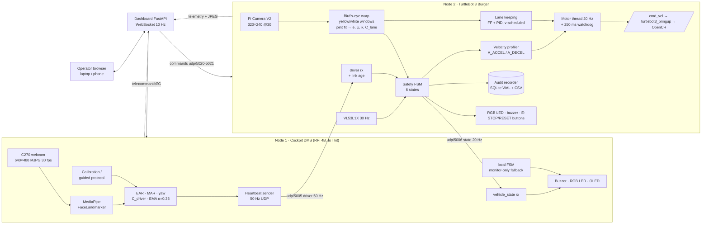
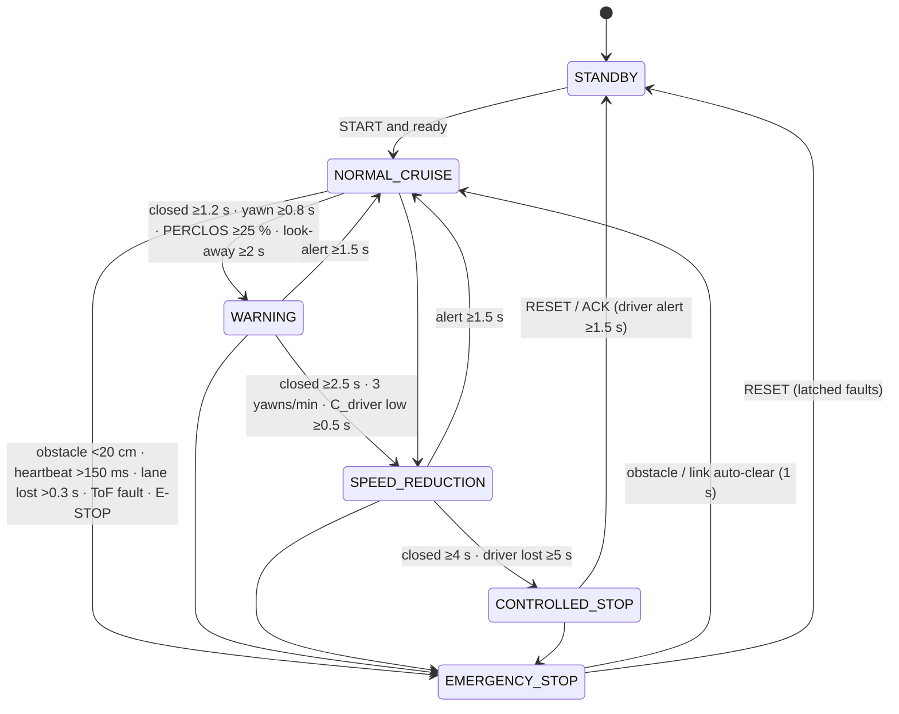

# Architecture

## System overview



The dashboard is **outside** the safety loop: losing it never stops the robot unexpectedly,
and every stop function also exists in hardware (buttons) and in the FSM itself.

## Supervisory FSM



Priority every tick: **commands → faults (EMERGENCY) → latched CONTROLLED_STOP → driver level**.

## Timing budget (Node 2, 30 Hz loop)

| Step | Typical (Pi 4) | Notes |
|---|---|---|
| frame grab | 0 ms (thread) | latest frame only, buffer size 1 |
| bird's-eye warp + segmentation + windows + fit | 4–8 ms | 240×180 BEV |
| FSM + profiler + PID | < 0.2 ms | |
| logging | < 0.05 ms | queue only |
| **total** | **< 10 ms** | 100 ms budget |

Node 1: FaceLandmarker on a Pi 4 at 640×480 ≈ 35–50 ms per frame → 20–28 fps (within the 100 ms
budget; reduce `driver.camera_width` to 480 if needed).

## Source layout

```
adowndriver/
  config.py                 all parameters (dataclasses) + YAML loading + runtime-tunable list
  common/protocol.py        UDP packets, endpoints   common/filters.py  EMA, median, persistence, PERCLOS window
  driver_monitor/           Node 1: analyzer.py (EAR/MAR/pose/C_driver/calibration), backend.py (MediaPipe), node.py
  vehicle/                  Node 2: lane.py, camera_model.py, control.py, fsm.py, core.py (one control step), io.py, node.py
  hardware/                 peripherals.py (LED/buzzer/buttons/OLED with mock fallback), selftest.py
  audit/                    recorder.py (SQLite/CSV), metrics.py (M1–M5)
  sim/                      world.py (track, robot, ToF, renderer), synthetic_driver.py, scenarios.py, runner.py
  dashboard/                server.py (FastAPI), static/ (HTML/CSS/JS, no CDN)
tests/                      53 pytest tests (FSM, lane, control, analyzer, protocol/audit, SIL)
tools/calibrate_lane.py     homography + colour calibration
cad_models/generate_stl.py  parametric 3D-printed parts
deploy/                     setup scripts + systemd units
```

## Team ownership

| Module | Owner |
|---|---|
| Architecture, `vehicle/fsm.py`, integration | Li Vladislav |
| `driver_monitor/analyzer.py`, `backend.py` | Li Andrey |
| `vehicle/lane.py`, `camera_model.py`, `control.py`, `tools/calibrate_lane.py` | Pak Nikita |
| `common/protocol.py`, `vehicle/io.py`, `deploy/` | Vadim Lifrov |
| `dashboard/` | Hsu Shwe Sin Htun |
| `hardware/peripherals.py`, wiring | Egamberdiev Saidumar |
| `audit/recorder.py` | Husan Tulaev |
| `sim/`, `audit/metrics.py`, `tests/` | Dilshod Obidov |
| `cad_models/` | Fazliddin Igamberdiev |
| Confidence matrix & watchdog (`fsm.py` faults, motor watchdog) | Arsen Baktybek uulu |
| `docs/`, demo video | Sevinchxon Khoshimova |
